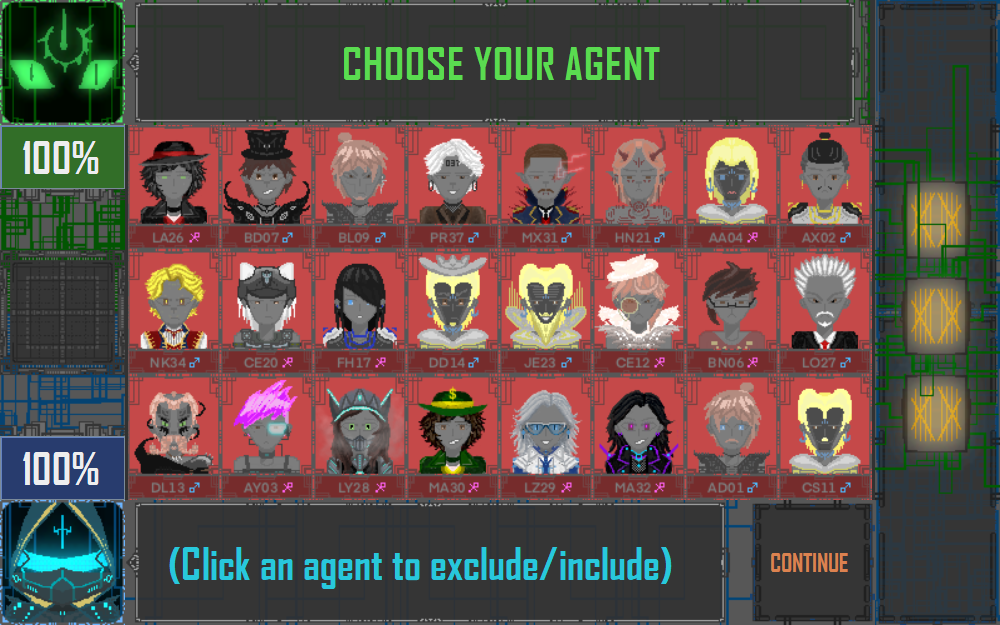

# Gesture-Controlled Tabletop Interface

A camera-based interface that turns hand movements into application input. I use Python, OpenCV and MediaPipe to track a hand, map its position into a Java window, and select controls with a pinch. An Arduino Mega provides LED feedback. Guess Who is the first application I used to test the idea.

## Why I Built This

Back in high school, during my Grade 11 year, I spent a lot of time working on this ISP Guess Who game. This game was one of the starting points that sparked my interest in programming and building a game of my own from scratch, from designing the characters and GUI to creating the music. After finishing it, I wasn't satisfied with just letting all that hard work sit in a folder on my computer. I wanted to find a way to bring the game back and do something different with it. With the naive idea of recreating Iron Man's JARVIS system, I decided to try implementing my game in a completely different way, turning it into an interactive tabletop game and controlling it with hand gestures directly on the table.

This repository builds on that work with camera input, calibration, communication and hardware feedback. Guess Who provided real controls and game states to test.

## What I did

- Tracked the index fingertip using OpenCV camera frames and MediaPipe hand landmarks.
- Added pinch detection with separate press/release thresholds, debounce and cooldown so one held pinch does not repeatedly click.
- Used four-point calibration to map camera coordinates into the application viewport.
- Sent selections from Python to Java over TCP, using the same Swing button actions as mouse input.
- Connected Java to an ELEGOO Mega 2560 over USB serial for onboard LED feedback.
- Added a resizable presentation mode and designed a small buzzer-driver PCB in KiCad.

## How it works

Camera → Python hand tracking → calibrated coordinates → Java controls → Arduino LED feedback

I select four corners in the camera image to define the interaction area. A homography transforms positions inside that area into a rectangular viewport. Java maps those positions to the current window and finds the button underneath. A pinch sends a selection; opening the fingers prepares the next one.

Python and Java exchange newline-delimited JSON over local TCP. Responses report whether an action executed, and event IDs prevent duplicate requests from repeating it. Eligible character-card changes queue a serial `BLINK` command without blocking the game window.

The current demonstration uses my laptop and built-in webcam. I have physically confirmed mouse and webcam-pinch control with Mega LED feedback. An HDMI projector is the intended tabletop display, but physical projection and an external overhead webcam have not yet been tested.

## Hardware

The tested setup uses a laptop, its webcam, an ELEGOO Mega 2560 and a USB data cable. The Mega's onboard D13 LED needs no extra wiring.

The [KiCad buzzer-driver project](hardware/kicad/buzzer-driver-pcb/README.md) includes an editable schematic, routed PCB, 3D renders and check reports. I have tested the PN2222 transistor wiring and confirmed that the buzzer circuit works. The PCB is a real editable board design with components, footprints and copper traces; fabrication and assembled-PCB testing are separate steps that have not been reported. The [hardware guide](hardware/README.md) records the connections and parts.

## Challenges Faced

## Build Photos

*I'll add my own setup and build photographs here.* Put real images in [photos/](photos/README.md); that folder includes a Markdown example for adding captions. The screenshot above shows the application.

## Setup and files

Start with the [Windows setup guide](docs/setup.md). It uses JDK 17, Python 3.12 and pinned dependencies. See [testing](docs/testing.md) for repeatable checks and [projector setup](docs/projector-setup.md) for laptop practice and future Extend-mode use.

| Folder | Contents |
| --- | --- |
| `src/` | Java game and input integration |
| `computer-vision/` | Tracking, pinch detection and calibration |
| `assets/` | Button images, portraits, interface artwork and audio |
| `arduino/` | Firmware, serial controller and firmware tests |
| `hardware/` | KiCad PCB, drawings and spatial concept |
| `screenshots/`, `photos/` | Actual application captures and future build photographs |
| `tests/`, `docs/` | Regression tests and supporting guides |
