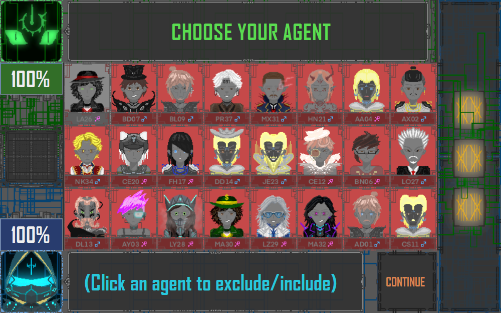
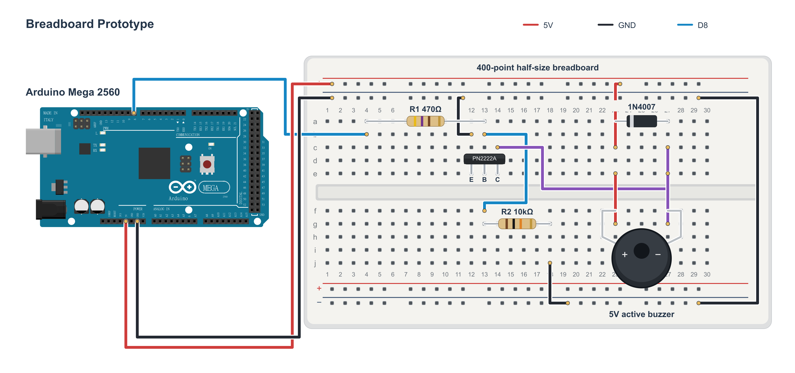
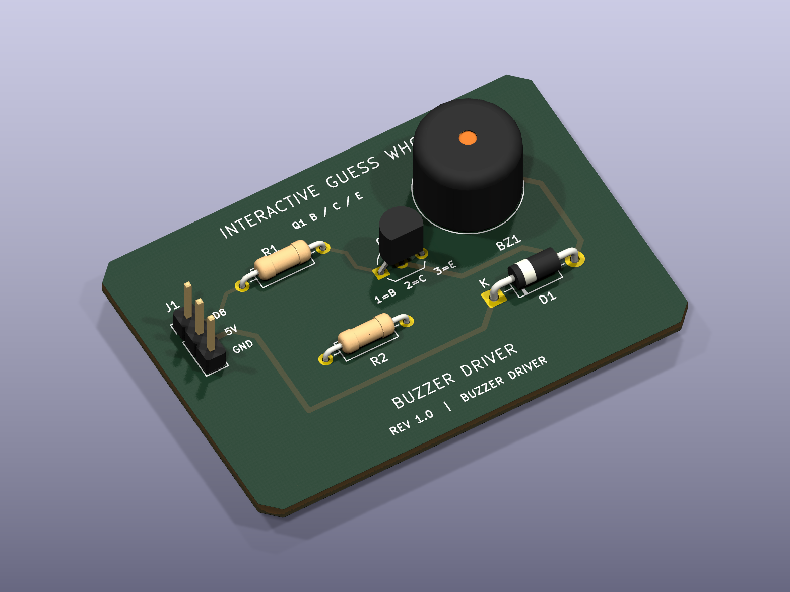

# Gesture-Controlled Tabletop Interface

I built a webcam-based interface that lets me play my Java Guess Who game by pinching to select cards. Python tracks my hand, four-point calibration maps the camera view to the game window, and an Arduino Mega lights its onboard LED in response to character-card actions.

[Windows setup](docs/setup.md) · [Hardware files](hardware/README.md) · [Software checks](docs/testing.md)

## Why I built this

I first built Guess Who for my Grade 11 programming project, from the character artwork to the interface and music. I wanted to bring it back with a different way to play. Inspired by JARVIS, I set out to turn hand gestures into game controls, starting with the webcam on my laptop.

## What I built

- **Hand tracking and pinch detection.** I used OpenCV and MediaPipe to track my fingertip and detect a pinch as a selection.
- **Four-point calibration.** I mapped a rectangle in the camera image to the game window so I could aim at cards from the calibrated area.
- **Java game integration.** Python sends selections over TCP. Java runs the same button action for a pinch and a mouse click.
- **Arduino feedback.** The Java game sends a USB-serial command to the Mega 2560 to trigger its onboard LED. I also built and tested a breadboard buzzer circuit using a standalone command.

## Hardware

The laptop and built-in webcam handle input. The ELEGOO Mega 2560 provides LED feedback and drives a 5 V active buzzer through a transistor circuit on a breadboard. Game-triggered buzzer audio is a future step.

[Wiring and connections](hardware/breadboard/README.md) · [Parts list](docs/hardware-bom.md)

## Running it

Start with the [Windows setup guide](docs/setup.md). It covers JDK 17, Python 3.12, building the game with `build-phase7a.ps1`, and calibrating the webcam. Run the commands from the repository root so the game can find its assets. The Arduino is optional for mouse and gesture control.

| Folder | Contents |
| --- | --- |
| `src/` | Java game and gesture input integration |
| `computer-vision/` | Hand tracking, pinch detection and calibration |
| `arduino/` | Mega firmware and Java serial controller |
| `hardware/` | Breadboard wiring, KiCad PCB and tabletop CAD concept |
| `assets/` | Game artwork and audio |
| `screenshots/` | Captures from the Java game |
| `docs/`, `tests/` | Setup guides and verification |

## Next steps

- [Test tabletop projection](docs/projector-setup.md) with an external webcam and check the alignment between the projected image and the calibrated input area.
- Connect buzzer feedback to game actions.
- Fabricate and test the [KiCad buzzer-driver PCB](hardware/kicad/buzzer-driver-pcb/).

