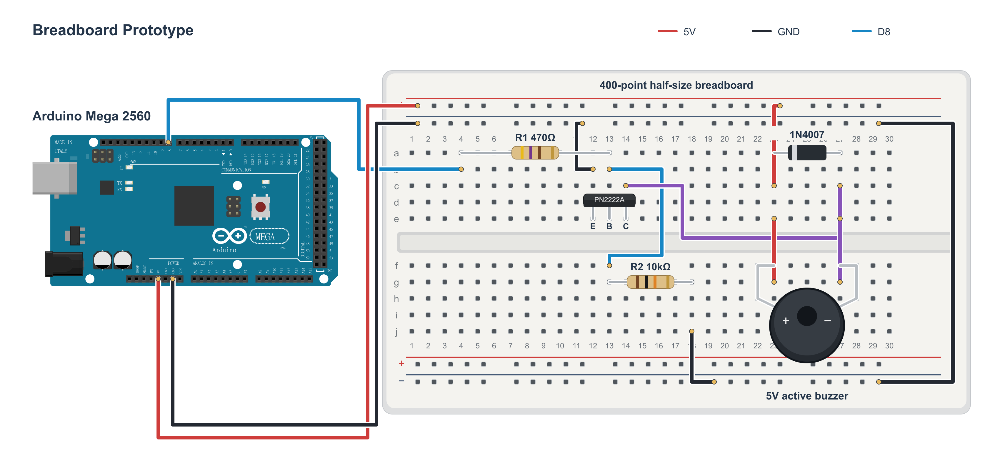
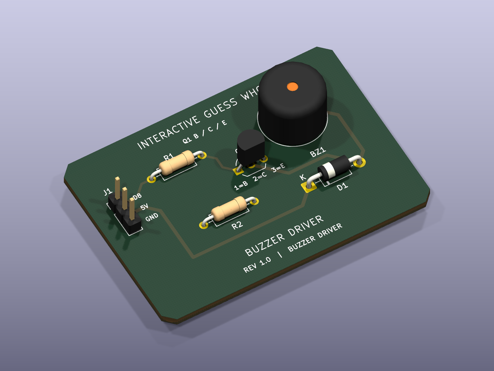

# Gesture-Controlled Tabletop Interface

A camera-based interface for controlling applications with hand gestures. Guess Who is the first application I used to demonstrate it.

[Setup](docs/setup.md) · [Hardware files](hardware/README.md) · [Tests](docs/testing.md)

## Why I Built This

Back in high school, during my Grade 11 year, I spent a lot of time working on this ISP Guess Who game. This game was one of the starting points that sparked my interest in programming and building a game of my own from scratch, from designing the characters and GUI to creating the music. After finishing it, I wasn't satisfied with just letting all that hard work sit in a folder on my computer. I wanted to find a way to bring the game back and do something different with it. With the naive idea of recreating Iron Man's JARVIS system, I decided to try implementing my game in a completely different way, turning it into an interactive tabletop game and controlling it with hand gestures directly on the table.

## How It Works

Camera → Python/OpenCV/MediaPipe → Java Guess Who → Arduino Mega 2560

Python tracks my fingertip and detects a pinch as a selection. Four-point camera calibration maps the interaction area into the game window. Python sends the selection over TCP, and Java uses the same button actions as a mouse click. The Mega's onboard LED responds to character-card actions through USB serial.

I have tested mouse and webcam-pinch control with Arduino LED feedback on my laptop. The resizable interface is ready for a future projector setup, but I have not physically tested tabletop projection or an external webcam yet.

## Hardware

My main prototype uses an ELEGOO Mega 2560, a 400-point half-size breadboard, jumper wires and a PN2222/2N2222A transistor-driven 5V active buzzer. The circuit includes a 470Ω base resistor, 10kΩ pull-down and 1N4007 diode. I have tested the wiring and confirmed that the buzzer works. BUZZ is a standalone command; automatic game sound is not integrated.

[Editable drawing and connections](hardware/breadboard/README.md). My laptop and built-in webcam handle input; a projector is the intended tabletop display. The D13 LED is already on the Mega, so there is no external LED circuit.

## Build Photos

I'll add my own hardware photographs here. Images belong in [photos/](photos/README.md).

<!-- Add real photos here, for example:  -->

## Setup and Files

Start with the [Windows setup guide](docs/setup.md) to install the dependencies, build Java and run hand tracking. Run commands from the repository root so the game can find its assets. See [testing](docs/testing.md) for repeatable checks and [projector setup](docs/projector-setup.md) for calibration and future display use.

| Folder | Contents |
| --- | --- |
| `src/` | Java game and input integration |
| `computer-vision/` | Python hand tracking, pinch detection and calibration |
| `assets/` | Button images, character portraits, interface artwork and audio |
| `arduino/` | Mega firmware, Java serial controller and hardware-free tests |
| `hardware/` | Breadboard drawing and concept PCB design |
| `photos/`, `screenshots/` | Future real build photos and actual game captures |
| `docs/`, `tests/` | Supporting guides and regression tests |

## Challenges Faced

## **Next Step: Concept PCB Design**

I designed this PCB in KiCad to bring the working breadboard buzzer circuit onto a dedicated board. The [editable schematic and routed PCB files](hardware/kicad/buzzer-driver-pcb/) include the components, footprints and copper traces. Fabricating and testing the assembled PCB is the next step.

