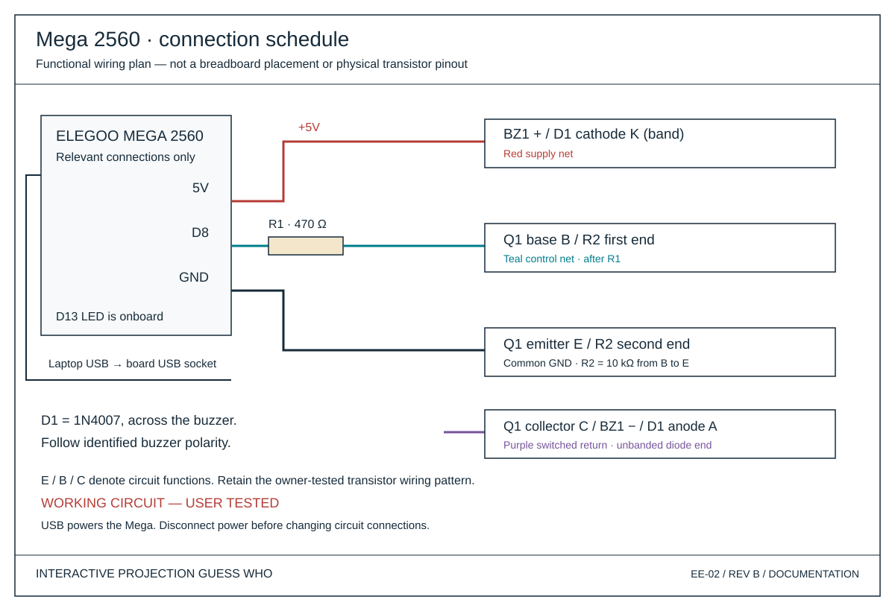

# Pin connections — Phase 6A

**Working circuit — owner tested.** The owner confirmed successful PN2222 wiring and buzzer operation. This schedule labels electrical functions; it does not impose a new left/middle/right lead orientation. PCB footprint fit and assembled-board testing remain separate from the working wired circuit.

| From | To | Meaning |
| --- | --- | --- |
| Computer USB | Mega USB socket | Existing serial data and USB power; disconnect before rewiring |
| Mega D8 | R1 input | Buzzer-control output; never directly to the buzzer |
| R1 output | Q1 B and R2 top | 470Ω series base drive |
| R2 bottom | Q1 E / Mega GND | 10kΩ pull-down |
| Mega 5V | BZ1 + and D1 K | Positive buzzer supply; diode band identifies K |
| BZ1 − | Q1 C and D1 A | Switched negative node; diode unbanded end identifies A |
| Q1 E | Mega GND | Common return |
| LED_BUILTIN / D13 | Existing onboard L LED | No additional breadboard circuit |

Q1 B = base, C = collector, E = emitter. Pin identifiers in the editable schematic represent these functions only. Buzzer polarity must follow its identified + terminal, not an assumed trimmed-lead length. R1/R2 are not polarized. D1 is across the buzzer, with its band at +5V, not in series.

## Reading the wiring plan

Red is +5V; teal is the D8/base signal; purple is the switched negative node; dark wires are ground/return. The drawing is a functional connection schedule, not a physical breadboard layout. It deliberately assigns no breadboard rows or transistor package positions. Each boxed endpoint lists terminals on the same net; use the schematic to see the complete circuit. R2 bridges the base and ground nets. The USB label denotes the board's USB socket.

The earlier Phase 5C breadboard illustrations remain historical planning references, not a verified placement guide. The current connection schedule replaces the stylized board/breadboard illustration in the portfolio.

## Interfaces outside the breadboard

USB webcam → Python capture; Python ↔ Java uses newline-delimited UTF-8 JSON over TCP at default 127.0.0.1:5050 (configurable). Java ↔ Mega uses USB serial, 9600 baud, 8 data bits, no parity, 1 stop bit; COM port is configurable (COM5 previously used). Java rendering reaches the planned projector through the computer's graphics/HDMI output.

The existing game sends BLINK for card feedback. BUZZ remains a standalone firmware command: immediate ACK BUZZ, D8 HIGH for 180ms, then LOW. It is not connected to Java game sound events. PING, LED_ON, LED_OFF and BLINK remain unchanged by this documentation phase.

No WS2812B pin is allocated. Its supply, data interface, grounding and protection remain separate future design work.
