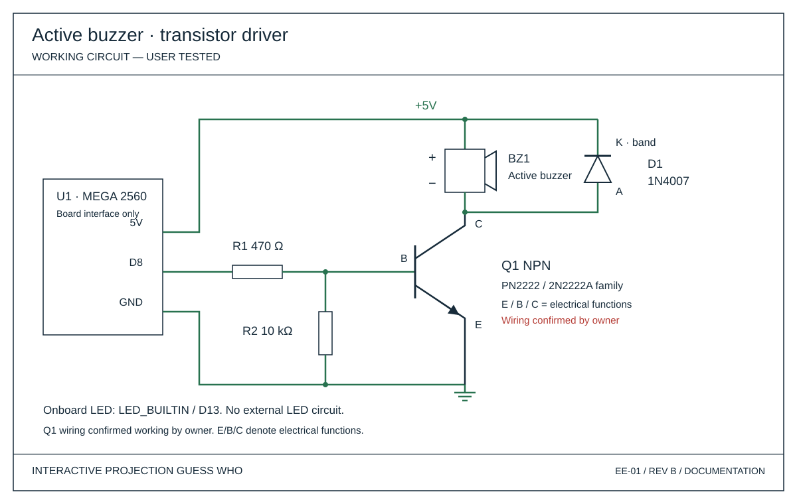

# Gesture-Controlled Tabletop Interface — hardware

The main prototype uses an ELEGOO Mega 2560, breadboard, jumper wires and the working transistor-driven active buzzer. The Mega’s onboard D13 LED provides feedback from mouse and gesture actions; no external LED is used.

## Breadboard wiring

[Open the editable breadboard diagram and connection table](breadboard/README.md). It uses the owner-confirmed E–B–C transistor orientation and a 400-point board.

## Optional PCB design

[Open the KiCad buzzer-driver project](kicad/buzzer-driver-pcb/README.md) for editable schematic and PCB files, 3D renders, STEP and actual ERC/DRC reports. This optional routed daughterboard integrates the breadboard buzzer circuit. It does not replace the main prototype; fabrication and assembled-board testing have not been reported.

## Electrical design

| Document | Purpose |
| --- | --- |
| [Schematic SVG](../docs/images/buzzer-schematic.svg) | Readable electrical circuit |
| [Connection schedule](../docs/images/arduino-wiring.svg) | Color-coded nets and functional endpoints |
| [KiCad source](kicad/README.md) | Editable functional schematic; native parsing checked |
| [BOM](../docs/hardware-bom.md) | Components and design status |
| [Pin connections](../docs/pin-connections.md) | Detailed connection and polarity reference |
| [Validation record](../docs/hardware-validation-status.md) | What was actually checked |

The optional D8 active-buzzer driver is **working, physically tested by the owner**. It retains the 470 Ω base resistor, 10 kΩ pull-down, 1N4007 diode and NPN transistor. E/B/C identify electrical functions only; the owner confirmed the PN2222 wiring pattern works. The editable PCB design is linked above; no fabrication Gerbers are provided.

## Spatial concept

[Concept CAD](concept-cad/README.md) is a separate presentation study showing relative desk, camera and projector positions. Its approximate shapes do not represent purchased equipment or a validated support structure. It is not part of the tested hardware assembly.

## Drawing sources

[Documentation drawing generator](drawings/README.md). Current drawings use schematic symbols and connection schedules rather than simulated board photographs. Historical phase drawings remain available through the [documentation index](../docs/README.md).
