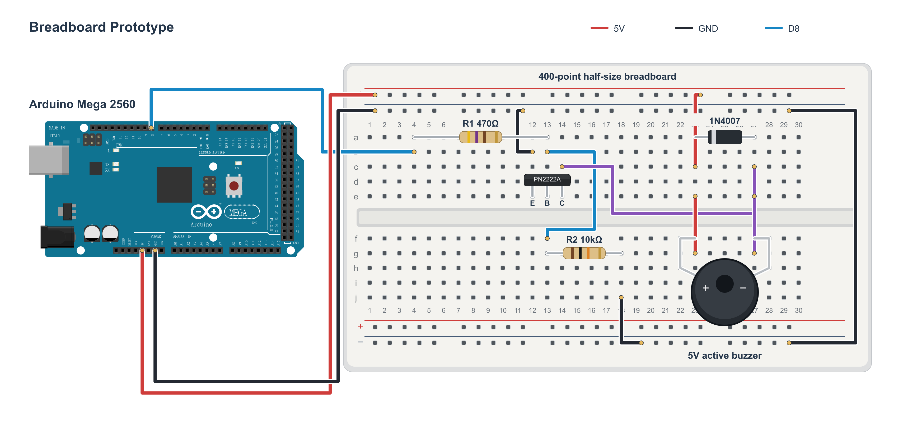

# Mega + breadboard wiring

The main hardware prototype uses an ELEGOO Mega 2560 and a 400-point half-size breadboard. The owner confirmed the transistor circuit works and supplied this physical orientation: **flat/text face toward you, legs down → left E, middle B, right C**.



This is a proposed, reproducible hole layout of that working circuit, not a photograph or a claim that these are the owner's exact occupied holes. The transistor is drawn face-on so its three leads are easy to follow. Other shapes and lead bends are illustrative rather than dimensional templates. The Arduino Mega artwork represents the compatible header layout; it is not an ELEGOO product photograph.

## Files and free tools

- [tabletop-wiring.svg](tabletop-wiring.svg): self-contained editable vector drawing; open in a browser or edit using free [Inkscape](https://inkscape.org/).
- [tabletop-wiring.png](tabletop-wiring.png): 3400 × 1600 GitHub preview.
- [generate.py](generate.py): Python standard-library SVG generator; editable shapes, labels and wires.
- [mega-2560.svg](mega-2560.svg): original Mega vector artwork embedded by the generator.
- [connections.json](connections.json): component holes and jumper endpoints, generated with the SVG; not a Wokwi project.
- [validate.py](validate.py): breadboard connectivity and hole-use checks.
- [validation.txt](validation.txt): actual connectivity check result.

No paid tool was used. Fritzing and Inkscape were not found on PATH or in the checked standard installation folders. Wokwi's [documented buzzer](https://docs.wokwi.com/parts/wokwi-buzzer) is tone-driven; its [built-in hardware list](https://docs.wokwi.com/getting-started/supported-hardware) does not document the needed PN2222/1N4007 circuit. It was not used to simulate or substitute parts. Circuit Canvas was opened in its guest editor. Mega and half-size breadboard parts were added to a starter layout, but Export displayed “Create a free account to export your circuit”. No Circuit Canvas PNG or editable source has been exported. The starter is incomplete and is not a validated second diagram. The explicitly permitted SVG fallback avoids claiming either native format. No `.fzz` or Wokwi `diagram.json` is supplied.

## Hole-by-hole placement

Unplug USB before changing wiring. Letters a–e at one number are internally connected; f–j at the same number form a separate group. The center trench isolates them. Rail labels P/N mean upper +/−; p/n mean lower +/−. Rail positions 1–25 count **holes**, not the terminal-column numbers. Top + and top − are each treated as continuous rails. Bridge any break on your actual board before using the whole rail. Lower + is unused; the black N25–n25 jumper joins the two ground rails.

| Part | Holes / orientation |
| --- | --- |
| Q1 emitter, base, collector | e12, e13, e14 respectively; confirmed E–B–C front view |
| R1 470Ω | a4–a13; yellow, violet, brown, gold |
| R2 10kΩ | g13–g18; brown, black, orange, gold |
| D1 1N4007 | Banded cathode a23 (+5V), unbanded anode a27 (collector) |
| BZ1 5V active buzzer | Positive f23; negative f27 |

| Jumper | Color | Endpoints |
| --- | --- | --- |
| Control | Blue | Mega D8 → b4 |
| Supply | Red | Mega 5V → upper + hole 1 |
| Return | Black | Mega GND → upper − hole 1 |
| Ground rail bridge | Black | Upper − hole 25 → lower − hole 25 |
| Emitter return | Black | b12 → upper − hole 10 |
| Pull-down return | Black | j18 → lower − hole 16 |
| Base junction | Blue | b13 → f13 |
| Buzzer supply | Red | Upper + hole 20 → c23 |
| Collector junction | Purple | c14 → c27 |
| Buzzer positive bridge | Red | e23 → g23 |
| Buzzer negative bridge | Purple | e27 → g27 |

The diode is **across** the buzzer, not in series. D8 connects through R1 to the base; R2 returns the base to GND. The collector switches buzzer negative. Crossed wires are insulated; only endpoints connect to holes. Gold endpoint circles identify jumper insertions. The onboard D13 LED needs no external LED.

## Optional PCB

The [KiCad design](../kicad/buzzer-driver-pcb/README.md) is preserved as an optional way to integrate this breadboard circuit. Its existing Q1 footprint is numbered **1=B, 2=C, 3=E**, while this owner's transistor is physically **E–B–C** in the stated front view. Do not assume it is a drop-in fit: reconcile footprint orientation/pad mapping with the actual package before PCB assembly. No KiCad files were changed for this diagram. Fabrication and assembled-PCB operation remain separate from the working breadboard circuit.

## Reproduce and validate

From the repository root:

```powershell
py hardware/breadboard/generate.py
py hardware/breadboard/validate.py
```

The PNG was exported using free Node.js + Sharp. Alternatively, install free Inkscape and export:

```powershell
inkscape hardware/breadboard/tabletop-wiring.svg --export-type=png --export-width=3400 --export-filename=hardware/breadboard/tabletop-wiring.png
```

The validator checks the five conductive nets against the documented circuit, component endpoint isolation, physical hole conflicts and the confirmed E–B–C placement. It is not an electrical simulation. The SVG/PNG were opened and inspected for labels, polarity, placement and wire routing. No new hardware test or software/firmware change was performed.

## Artwork and references

Mega artwork: `althaus`, Arduino/Fritzing, distributed in the [official Arduino Mega resource bundle](https://docs.arduino.cc/hardware/mega-2560/) (`A000067-fritzing.fzpz`). Header endpoints use that part's connector IDs: D8 `connector243pin`, 5V `connector258pin`, GND `connector260pin`, cross-checked with the [official pinout](https://docs.arduino.cc/resources/pinouts/A000067-full-pinout.pdf). Board artwork is embedded, resized and wired; original breadboard/components/annotations were added with Python SVG generation. This is not a drawing authored in the Fritzing application.

Drawing and included Mega graphic: **[CC BY-SA 3.0](https://creativecommons.org/licenses/by-sa/3.0/)**, with credit to Arduino/Fritzing/althaus and this project for the added layout, under the [Fritzing graphics license](https://github.com/fritzing/fritzing-parts/blob/develop/LICENSE.txt). This applies to these drawing assets, not unrelated repository code. No photographs or AI-generated hardware images are used.

## Clean visual revision

The GitHub figure now keeps only the small title, board/component labels, polarity/terminal marks and a compact 5V/GND/D8 legend. Explanations and artwork attribution remain here instead of inside the image. The connection manifest is unchanged from the previous checked drawing.

Circuit Canvas comparison is blocked by its account-required export. To continue, sign in to Circuit Canvas with your own account; never send credentials in chat. The temporary starter URL is held in the chat rather than treated as a lasting deliverable. No imitation Circuit Canvas output is supplied.
