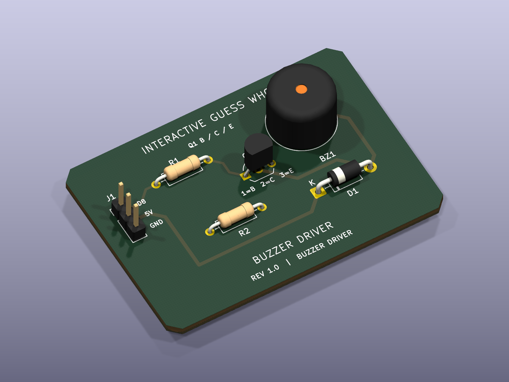
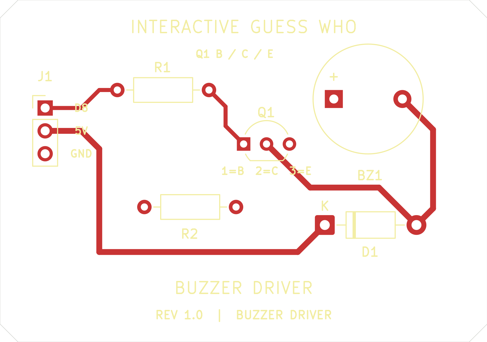
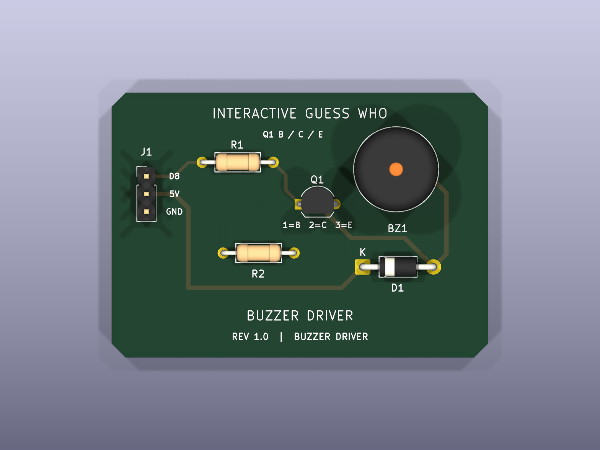
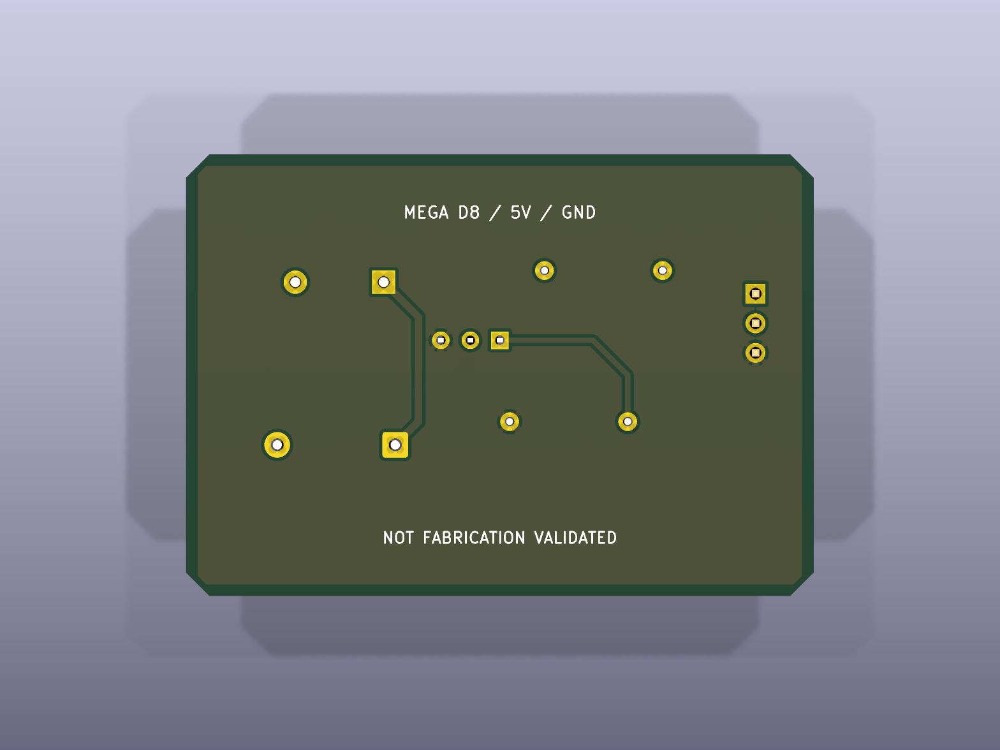

# Interactive Guess Who — Buzzer Driver PCB

**Working Wired Circuit — Editable PCB Design**

A native KiCad 10 daughterboard design for the existing Mega D8 active-buzzer circuit. This is a separate, wired daughterboard, not a shield that plugs directly into the Mega headers. The onboard D13 LED remains on the Mega.

| Native KiCad PCB rendering (not a photograph) | Front copper and footprints |
| --- | --- |
|  |  |

| Top | Bottom |
| --- | --- |
|  |  |

## Design

- 54 × 38 mm chamfered outline; two copper layers; 1.6 mm board thickness assumption.
- Six through-hole components, five electrical nets, 0.45 mm signal tracks and 0.65 mm supply/return tracks.
- Bottom GND copper zone with 0.30 mm clearance and thermal reliefs; explicit ground tracks also connect the ground pads.
- Project minimum clearance 0.25 mm, minimum track width 0.25 mm, copper-to-edge clearance 0.50 mm.
- Green mask appearance, reference designators, connector pin labels, polarity marks and project branding.
- No Gerbers generated; no board manufactured, powered or acoustically tested.

## Arduino interface

| J1 pad | Mega connection | Function |
| --- | --- | --- |
| 1 (square pad) | D8 | R1 input, active-high buzzer control |
| 2 | 5V | Buzzer positive and D1 cathode |
| 3 | GND | Common return |

R1 (470 Ω) drives Q1 base. R2 (10 kΩ) connects base to emitter/GND. Q1 collector switches the buzzer negative terminal. D1 (1N4007) is across the buzzer, cathode/band toward +5V. The existing standalone `BUZZ` firmware command is unchanged; this phase adds no Java sound integration.

## Explicit footprint assumptions

| Part | KiCad footprint / geometry | Qualification |
| --- | --- | --- |
| Q1 | `Package_TO_SOT_THT:TO-92_Inline_Wide`, 2.54 mm adjacent pad pitch | **PCB pad mapping: 1=B, 2=C, 3=E.** Uses generic `Transistor_BJT:Q_NPN_BCE`. The owner has confirmed the transistor wiring works; check that the tested lead arrangement fits these PCB pads before assembly. |
| BZ1 | `Buzzer_Beeper:Buzzer_12x9.5RM7.6`, nominal 12 mm body, 9.5 mm height, 7.6 mm lead pitch | Placeholder for a 5V active buzzer; actual kit buzzer geometry and fit are unverified. Pad 1=positive, pad 2=negative. |
| R1/R2 | `Resistor_THT:R_Axial_DIN0207_L6.3mm_D2.5mm_P10.16mm_Horizontal` | Generic axial resistor body and 10.16 mm formed-lead pitch, not measured kit parts. |
| D1 | `Diode_THT:D_DO-41_SOD81_P10.16mm_Horizontal` | Generic DO-41, 10.16 mm formed-lead pitch; pad 1=cathode. |
| J1 | `Connector_PinHeader_2.54mm:PinHeader_1x03_P2.54mm_Vertical` | Proposed 2.54 mm header, not a keyed connector or Mega mounting pattern. |

All six footprints reference installed KiCad STEP component models. Generic resistor models do not encode the actual resistance color bands. Models illustrate package classes, not exact purchased parts. Successful wired-circuit testing does not by itself establish fit in the selected PCB footprints.

## Open and inspect

1. In KiCad 10, choose **File → Open Existing Project** and select `buzzer-driver.kicad_pro` in this folder.
2. Open `buzzer-driver.kicad_sch` for the editable schematic, or `buzzer-driver.kicad_pcb` for the board.
3. In PCB Editor, use **View → 3D Viewer** (`Alt+3`). Drag to rotate and scroll to zoom.
4. Use **Inspect → Design Rules Checker** to rerun DRC. Enable schematic parity checking. Refill zones with **B** after edits.
5. In Schematic Editor, use **Inspect → Electrical Rules Checker** to rerun ERC.

Install KiCad's standard symbols, footprints and 3D models. Project-local `sym-lib-table` and `fp-lib-table` use KiCad 10 library variables; they do not replace global settings. STEP can be opened in a compatible mechanical CAD viewer, but it does not retain PCB net connectivity.

## Actual checks

KiCad **10.0.8**, 2026-10-31: ERC **0 errors / 0 warnings**; DRC **0 violations**, **0 unconnected pads**, **0 schematic parity problems**. See [validation details](VALIDATION.md) and the unedited reports. The owner subsequently confirmed working PN2222 wiring and buzzer operation. ERC/DRC and the wired-circuit test do not establish PCB package fit, fabrication quality or assembled-board operation.

The three high-resolution PNGs are native `kicad-cli pcb render` ray-traced images, not AI artwork. The layout SVGs are native KiCad copper plots; their PNG previews are rasterizations. The schematic SVG is exported by Eeschema. Morgan Wang's [metronome and buck-converter portfolio](https://portfolio.morgan-wang.workers.dev/) informed the presentation quality; no circuit, layout or image was copied.

## Files

- `buzzer-driver.kicad_pro` — project and design rules.
- `buzzer-driver.kicad_sch` — native schematic using standard symbols.
- `buzzer-driver.kicad_pcb` — native routed board with filled GND zone.
- `buzzer-driver.step` — board and component 3D exchange model.
- `sym-lib-table`, `fp-lib-table` — project-local library references.
- `images/pcb-editor-screenshot.png` — historical KiCad PCB Editor capture from before this label update; older status text is superseded.
- `images/pcb-isometric.png`, `pcb-top.png`, `pcb-bottom.png` — native 3D renders.
- `images/pcb-layout.svg`, `.png` — native front copper/silkscreen plot and preview.
- `images/pcb-bottom-copper.svg`, `.png` — bottom copper/silkscreen plot and preview.
- `images/buzzer-driver.svg`, `.png` — native schematic export and preview.
- `reports/erc.rpt`, `drc.rpt`, `netlist.net` — actual KiCad reports and exported netlist.
- `reports/model-check.json` — component model resolution and PCB inventory.
- `VALIDATION.md` — scope, remaining requirements and repeatable CLI commands.
- `generate_project.py` — source generator using KiCad's bundled Python; **overwrites native design files** when run. Do not run it over manual edits. Refill zones and rerun checks/exports after regeneration.
- `README.md` — this guide.

Before any future fabrication: match the tested Q1 wiring to PCB pads, measure BZ1 and all through-hole parts, revise footprints/mappings accordingly, verify selected parts' ratings and the USB power budget, review with the intended fabricator's rules, and repeat ERC/DRC. No purchase or fabrication is needed to view this design.
